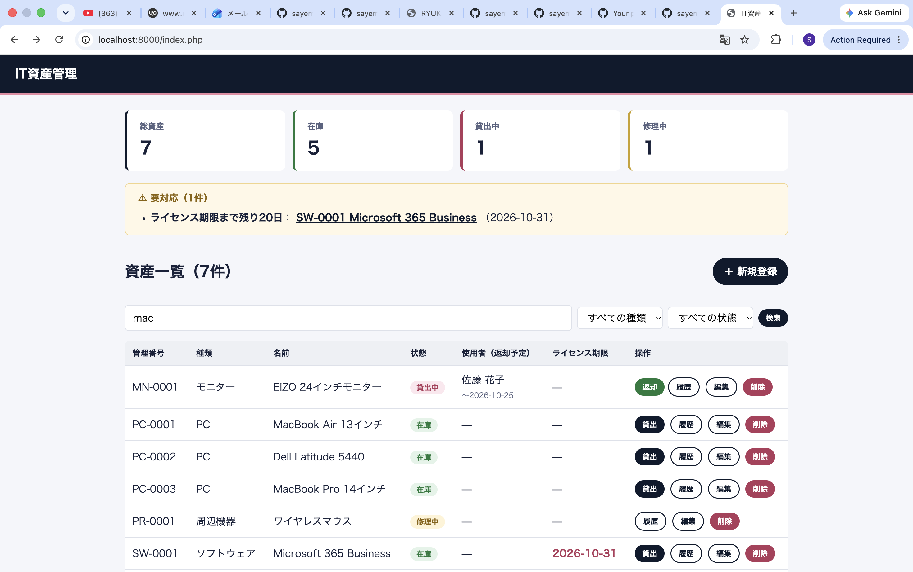
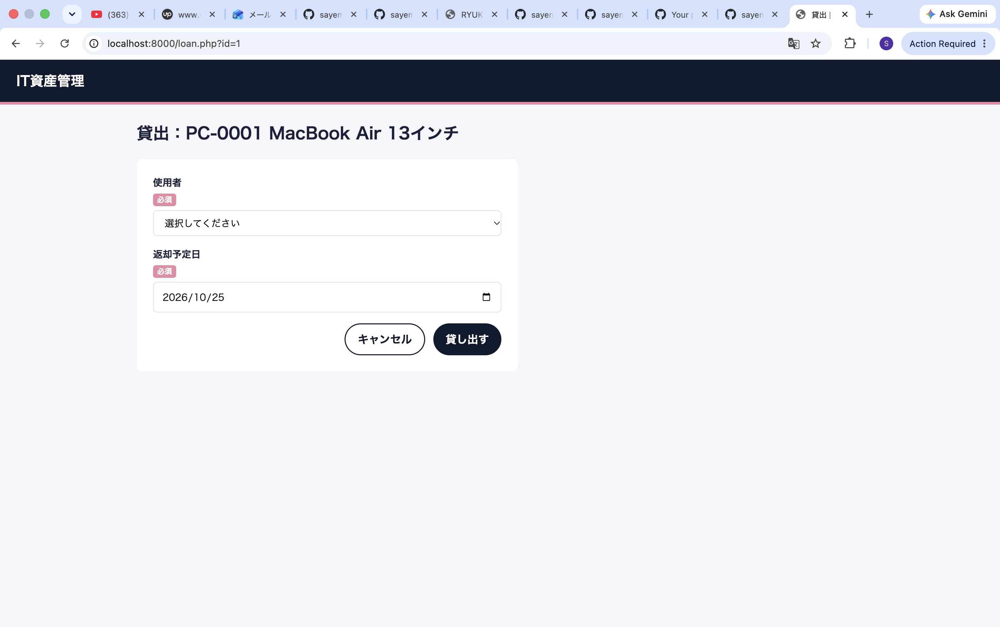

# 🖥️ IT資産管理システム（IT Asset Manager）

**社内のPC・モニター・ソフトウェアライセンスなどのIT資産を管理するWebアプリケーションです。**
資産の登録から、社員への貸出・返却、履歴の確認、ライセンス期限の通知までを一つのアプリで行えます。

*A web app for managing company IT assets — inventory, loans and returns with full history, and license-expiry alerts. Built with plain PHP 8 and MySQL, without a framework.*




---

## 主な機能

| 機能 | 内容 |
|---|---|
| **ダッシュボード** | 総資産・在庫・貸出中・修理中の件数をカードで表示 |
| **要対応アラート** | 30日以内に期限が切れるソフトウェアライセンスと、返却が遅れている貸出を自動で表示 |
| **資産の登録・編集・削除** | 入力チェック・管理番号の重複チェック付き |
| **貸出・返却** | 社員と返却予定日を指定して貸出。返却すると状態が自動で「在庫」に戻る |
| **貸出履歴** | 資産ごとに「いつ・誰が・いつまで」使っていたかを確認 |
| **検索・絞り込み** | 管理番号・名前・使用者のキーワード検索と、種類・状態での絞り込み |

| 貸出画面 | 貸出履歴 |
|---|---|
|  |  |

---

## 技術的な工夫

| 課題 | 解決方法 |
|---|---|
| **同じ資産の二重貸出** | 貸出処理をトランザクションで実行し、`SELECT … FOR UPDATE` で資産の行をロックしてから状態を確認。同時に操作しても、片方だけが貸出できます。 |
| **データの整合性** | 「貸出記録の追加」と「資産の状態変更」を同じトランザクションで実行し、途中でエラーが起きた場合はロールバックします。 |
| **履歴を残す設計** | 貸出履歴がある資産は物理削除できないようにし、「廃棄」ステータスで残します。後から確認・監査ができます。 |
| **SQLインジェクション対策** | すべてのSQLをPDOのプリペアドステートメントで実行（エミュレーション無効）。検索条件を動的に組み立てる場合も、値はすべてプレースホルダで渡しています。 |
| **XSS対策** | 画面に出力する値はすべて `htmlspecialchars` でエスケープしています。 |
| **CSRF対策** | フォームごとにトークンを発行し、`hash_equals` で検証しています。 |
| **二重送信の防止** | 登録・更新後はリダイレクトする PRG パターンを採用しています。 |
| **公開範囲の分離** | ドキュメントルートを `public/` に限定し、`lib/` や設定ファイルにはブラウザから直接アクセスできない構成にしています。 |
| **接続情報の管理** | DB接続情報は `config.php` に分離し、`.gitignore` でGitの管理対象から除外しています。 |

---

## データベース設計

```
employees（社員） ──┐
                    ├── loans（貸出履歴）
assets（IT資産） ───┘
```

- **assets** — 管理番号・種類・名前・状態（在庫／貸出中／修理中／廃棄）・購入日・ライセンス期限
- **employees** — 社員名・部署・メールアドレス
- **loans** — 貸出日・返却予定日・返却日（`NULL` ＝ 未返却）

貸出履歴を別テーブルにすることで、1つの資産を何度貸し出しても、すべての履歴が残ります。
詳しくは [`sql/schema.sql`](sql/schema.sql) をご覧ください。

---

## ディレクトリ構成

```
it-asset-manager/
├── config.example.php   # DB接続設定のサンプル
├── lib/
│   ├── db.php           # PDOによるDB接続
│   └── helpers.php      # エスケープ・CSRF・メッセージ表示などの共通関数
├── public/              # ドキュメントルート
│   ├── index.php        # ダッシュボード・一覧・検索
│   ├── create.php       # 新規登録
│   ├── edit.php         # 編集
│   ├── delete.php       # 削除
│   ├── loan.php         # 貸出
│   ├── return.php       # 返却
│   ├── history.php      # 貸出履歴
│   └── style.css
└── sql/
    ├── schema.sql       # テーブル定義
    └── seed.sql         # サンプルデータ
```

---

## ローカルでの起動方法

**必要なもの:** PHP 8.1 以上、MySQL 8 以上

```bash
# 1. データベースとサンプルデータを作成
mysql -u root < sql/schema.sql
mysql -u root < sql/seed.sql

# 2. 設定ファイルを作成（必要に応じて編集）
cp config.example.php config.php

# 3. 開発サーバーを起動
php -S localhost:8000 -t public
```

ブラウザで http://localhost:8000 を開くと表示されます。

---

## 今後の改善予定

- ログイン機能（管理者・一般社員の権限分け）
- 社員の登録・編集画面
- CSVエクスポート
- ライセンス期限のメール通知

---

## 作者

**アハメド サエム（Ahmed Sayem）**
流通科学大学 経済学部 経済情報学科 システムコース 3年

- ポートフォリオ: https://sayemahmed-jp.github.io
- GitHub: [@sayemahmed-jp](https://github.com/sayemahmed-jp)